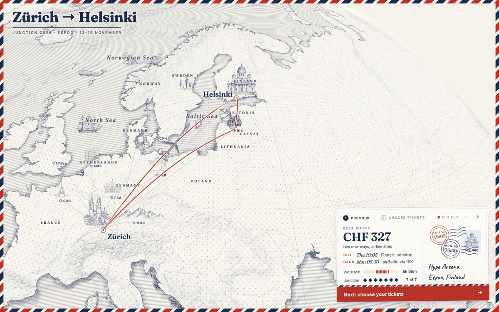
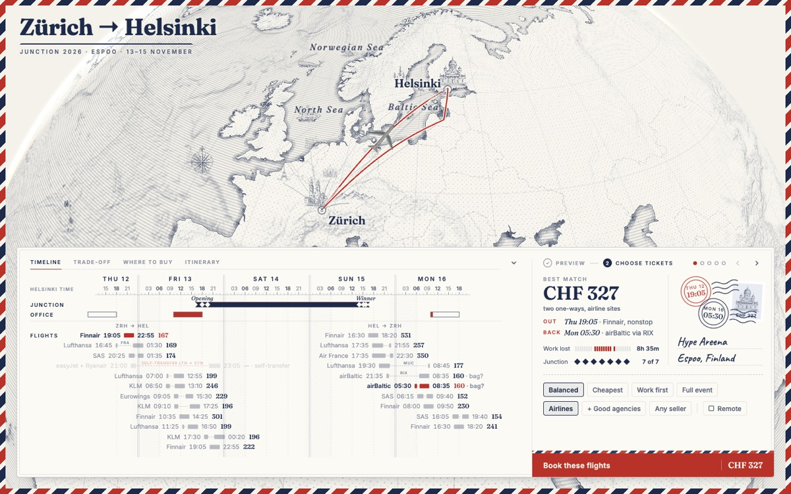

# Postcard

A skill for coding agents. It finds flights for a trip, shows them on an engraved airmail map,
and books the one you pick, up to the payment page.

You tell your agent where, when and why you travel. The agent reads real flights and prices in a
browser, writes them into one `trip.json`, and serves a page. On the page you compare the options
and click Book. The agent fills the booking in your browser and stops on the payment page. You
pay. The agent then adds the flights to your calendar and reminds you to check in.





The example is a real trip: Zürich to Helsinki for the Junction hackathon in November 2026, with
22 flights and their sellers as seen on Google Flights, Skyscanner and Kiwi.

## What the page shows

- **A globe** in the style of an engraved sea chart, with terrain and drawings that stand up like
  paper cut-outs. The chosen trip is red; a 3D plane flies along it when you hover the timeline.
- **A postcard** with the best match for your priority: price, both flights, the work hours you
  lose and the event moments you see.
- **Four views** of the same choice: a timeline of every flight against the event and your office
  hours, a price against work-lost chart, every seller per flight with its rating, and a door-to-door
  itinerary in local times.
- **Choices**: what matters most (balanced, cheapest, work first, full event), who may sell the
  tickets (airlines, good agencies, anyone), and whether you can work remotely on travel days.

The map uses OpenFreeMap tiles, AWS terrain tiles and Natural Earth. No API key is needed.

## Install

In Claude Code:

```
/plugin marketplace add henrikkvamme/postcard
/plugin install postcard@postcard
```

For another agent, copy `plugins/postcard/skills/postcard/` into its skills folder. The skill is a
`SKILL.md` with references, Python 3 scripts (standard library only) and a static web page.

Then ask, for example: "Find flights from Zürich to Helsinki for Junction, 12 to 16 November. I work
Friday and Monday."

## How it works

| Step | The agent |
| --- | --- |
| Brief | Asks for what it cannot find: dates, the event, work hours, sellers you accept. |
| Scrape | Reads schedules, sellers and deals with any browser tool. It does not solve captchas. |
| Write | Writes `trip.json` and checks it with `scripts/check_trip.py`. |
| Show | Serves the trip with `scripts/serve.py`. |
| Book | Waits for your Book click with `scripts/wait_checkout.py`, fills the booking, stops at payment. |

The agent can make each page its own. A file in the trip folder replaces the viewer's file with the
same path: new drawings, other copy, or a changed ranking model.

The data format is in
[`references/trip-schema.md`](plugins/postcard/skills/postcard/references/trip-schema.md).

## Develop

```sh
python3 tests/test_scripts.py
python3 plugins/postcard/skills/postcard/scripts/serve.py plugins/postcard/skills/postcard/examples/junction-2026
```

v1 covers flights. Trains and buses are next.

## License

MIT
